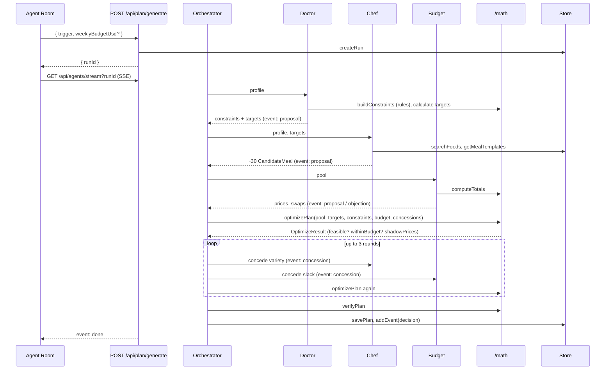

# Architecture

NutriPlan AI is one Next.js 15 app (App Router, TypeScript strict). Screens never talk to a database or a model; they call `/lib/api.ts`, which calls route handlers, which call the Store and the agents, which call the math. Every arrow below is a typed contract from `/types/contracts.ts`.

## Big picture

```mermaid
flowchart LR
  subgraph Browser
    S[Screens /app/(app)] --> H[/lib/hooks TanStack Query/]
    H --> A[/lib/api.ts/]
    A -. NEXT_PUBLIC_USE_MOCKS=true .-> M[(/mocks/*.json)]
  end
  A -->|fetch JSON + cookie np_uid| R[/app/api/* route handlers/]
  R --> AUTH[lib/auth/session.ts]
  R --> ST[lib/db Store interface]
  ST -->|DATA_BACKEND=memory| MEM[(.data/store.json)]
  ST -->|DATA_BACKEND=supabase| SB[(Supabase Postgres)]
  R --> AG[/agents orchestrator/]
  AG --> MATH[/math: targets, optimizer, kalman, metabolism/]
  AG --> RULES[(agents/rules/guidelines.json)]
  AG -->|AGENTS_MODE=live| LLM[Vercel AI SDK: Anthropic, OpenAI, Google]
  AG -->|AGENTS_MODE=scripted| SCR[canned outputs + real math]
  AG --> ST
  R -->|SSE agent_event / done| A
```

ASCII version:

```
screens -> lib/hooks -> lib/api.ts -> /app/api/* -> lib/db Store -> memory (.data) | Supabase
                           |                |
                      /mocks (flag)      /agents orchestrator -> /math  (numbers)
                                           |                 -> guidelines.json (rules)
                                           |                 -> AI SDK models (words) | scripted
                                           +-- SSE /api/agents/stream -> Agent Room
```

## Layers and owners

| Layer                      | Folder                                                   | Owner                                                                     | Notes                                                                   |
| -------------------------- | -------------------------------------------------------- | ------------------------------------------------------------------------- | ----------------------------------------------------------------------- |
| Screens, components, hooks | `/app/(app)`, `/app/(auth)`, `/components`, `/lib/hooks` | Frontend                                                                  | Four states, next-intl, tokens only                                     |
| Data gateway               | `/lib/api.ts`                                            | Frontend                                                                  | Mock switch, SSE subscribe, 600 ms fake delay                           |
| Route handlers             | `/app/api/*`                                             | Backend (most), Agents (plan/generate, agents, log/photo, coach, monitor) | `handler`, Zod validation, `{ error }` bodies                           |
| Session                    | `/lib/auth/session.ts`                                   | Backend                                                                   | `AUTH_MODE=local` cookie or Supabase Auth                               |
| Store                      | `/lib/db`                                                | Backend                                                                   | `MemoryStore`, `SupabaseStore`, `getStore()`                            |
| Agents                     | `/agents`                                                | Agents                                                                    | Orchestrator protocol, prompts, tools, schemas, rules, fallbacks, evals |
| Math                       | `/math`                                                  | Math                                                                      | Pure functions, HiGHS wasm with js fallback                             |
| Contracts                  | `/types/contracts.ts`                                    | Lead                                                                      | Only shared types                                                       |

## Plan generation sequence



Every event is stored with `store.addEvent` as it happens; the SSE route streams existing events first and then waits with `store.waitForEvents`. Reloading the Agent Room or calling `GET /api/agents/runs/[runId]` replays the same list.

## Vision voting

```
photo -> POST /api/upload -> url
url -> POST /api/log/photo
        |-> Vision A (provider 1) -> items A [{foodId, grams, confidence}]
        |-> Vision B (provider 2) -> items B
        match by foodId; similarity = min(g)/max(g); agreement = sum / distinct foods
        agreement >= 0.7 -> averaged grams -> computeTotals -> store.addFoodLog -> logged: true
        else            -> one question {text, options} -> logged: false -> client POST /api/log
        -> Monitor check (danger readings, flags)
```

## Monitor loop

```
POST /api/readings | POST /api/log | POST /api/monitor/run
  -> getTrends(readings, type)            Kalman: level + slope, 95% band, alert
  -> danger reading?  -> action: alert (urgent) and stop
  -> weight stalled / too_fast?           -> updateTdee(prior, intake, trend) -> calculateTargets(posterior)
  -> glucose rising (diabetes)?           -> tighten carbs within ADA rule
  -> replan at most once per day          -> POST plan/generate(trigger: monitor) -> Agent Room run
```

## Runtime modes

See the table in `/CLAUDE.md`. The same code serves: mocks only (Frontend day 1), memory backend with scripted agents (offline demo), memory backend with live agents (laptop with keys), Supabase with live agents (Vercel).

## Deployment

Vercel for the live URL (env: `DATA_BACKEND=supabase`, Supabase keys, model keys, `AGENTS_FALLBACK=true`). Docker image (`Dockerfile`, standalone output) for a self contained laptop or server fallback. Local Supabase via `npx supabase start` when testing the Postgres path.
